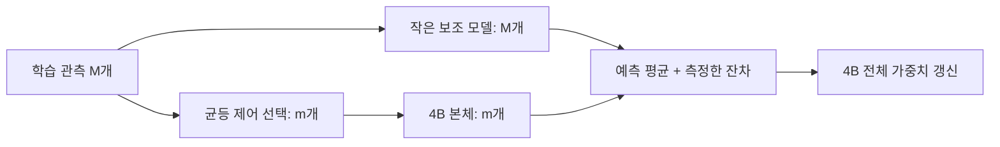

# Sejong 학습의 총 FLOPs를 줄이는 연구

2026-11-01. 목표는 RX 6600 한 장에서 같은 언어 품질에 도달할 때까지 필요한 부동소수 연산의 합을 줄이는 것이다. 무작위 초기값에서 본체 전체를 학습하는 조건을 사용한다. 총연산량은 데이터 처리, 본체·보조 모델 학습, 기저 갱신, 검증에 쓴 연산을 합산한다.

[결합 FLOPs 후속 연구](joint-flops.md)에서는 공유 encoder, 저랭크 지연 갱신, 같은 4B 용량의 GQA·전문가 구조와 층화 제어 표집을 함께 계산한다. 타일 패딩과 구성 간 상호작용도 비용에 포함한다.

이번 연구의 우선 후보는 **작은 보조 모델에서 수정 방향을 예측하고, 일부 관측에만 큰 본체의 순전파·역전파를 실행해 오차를 교정하는 방식**이다. 기울기 평균을 유지하는 조건, 저랭크 구현식, 예측 실패를 판정하는 분산 기준을 정리했다. 함께 검토한 두 축은 기존 예측 기울기의 행렬곱 재배치와, 무거운 본체가 여러 byte마다 한 번 작동하는 계층 구조다.

| 연구 산출물 | 상태 |
| --- | --- |
| 현재 코드의 연산 집계 | 행렬곱·attention 내적, checkpoint 재계산과 타일 padding을 정적으로 계산 |
| 누적 저랭크 미분 | 원래 추정량과의 항등식을 유도하고 CPU FP64로 확인 |
| 보조 모델 기반 교정 | 큰 본체의 계산 생략 조건과 불편 추정량을 설계; 평균·분산 분해를 수치 확인 |
| byte 구간별 본체 실행 | shift·pooling·decode·미분 전달을 설계하고 연산량 계산 |
| GPU·언어 평가 | 실제 커널 실행량과 고정 검증 자료의 품질 곡선을 후속 측정 항목으로 지정 |

[계산 스크립트](../../scripts/research-flops.py)와 [계산 결과](flops-results.json)를 함께 저장한다. 실행은 NumPy를 사용한 행렬 항등식 대조와 형상 계산이다.

```bash
OPENBLAS_NUM_THREADS=1 python scripts/research-flops.py \
  --out docs/research/flops-results.json
```

먼저 연산 단위를 정했다. FMA는 2 FLOPs, `(m×k)(k×n)`은 `2mnk`로 센다. 학습의 기준량은 같은 raw byte 수다. 아래 주 수치는 **행렬곱과 attention의 내적·벡터 가중합**을 합한 것이다. 보조 모델 표에는 SGD, 기울기 투영·복원, 기저 갱신과 통계 비용을 추가했다. exp·sigmoid·norm·형 변환·메모리 전송은 연산 종류를 구분해 후속 계측한다. CPU/GPU 시간으로의 환산은 실제 실행에서 얻은 처리율을 사용한다.

현재 `configs/sejong.toml`의 모델은 27,534,848개 파라미터, 학습 길이 512 bytes다. `sejong-model/src/lib.rs::layout`과 같은 구조를 d=2560, 32층, 40 heads, FFN=12800으로 확대하면 3,986,071,040개 파라미터가 된다. 아래 약 4B dense 기준은 이 형상이다. 선행 연구의 4.004B 희소 기억 형상은 별도 설계 축이다.

| 512-byte 관측의 byte당 주요 연산 | 약 4B dense 기준 |
| --- | ---: |
| 가중치 행렬곱 순전파 | 7.9705 GFLOPs |
| 입력·가중치 미분 행렬곱 | 15.9410 GFLOPs |
| attention 순전파 내적 | 0.0840 GFLOPs |
| attention 역전파 내적 | 0.3364 GFLOPs |
| 합계 | 24.3319 GFLOPs |
| 블록 checkpoint를 적용한 합계 | 32.3851 GFLOPs |

가중치 행렬곱이 이 합계의 **98.27%**를 차지한다. FFN 학습에 해당하는 행렬곱은 byte당 18.8744 GFLOPs다. 현재 구현의 attention 역전파는 `attention_dq`와 `attention_dkv`가 score와 일부 내적을 다시 계산하므로, 해당 커널의 식을 직접 집계했다. 미래 최적화 커널을 기준으로 계산할 때는 이 항을 다시 산출한다.

현재 GEMM의 `BM=16, BN=32, BK=32`와 attention의 `BK=32`, head 폭 padding을 포함하면 같은 약 4B 기준은 24.3578 GFLOPs/byte다. 기본 27.5M 형상은 checkpoint 포함 0.2441 GFLOPs/byte, 같은 타일 계산은 0.2457 GFLOPs/byte다. 출력 vocabulary=257의 cross-entropy는 byte마다 257개 logit을 다룬다. 큰 비용을 줄이는 연구 대상은 본체의 큰 행렬곱이 반복되는 횟수와 크기로 좁혀진다.

첫 번째 개선은 [앞선 기울기 연구](gradient-learning.md)의 예측식을 인수 형태로 끝까지 유지하는 것이다. 선형 연산 `Z=XW`에서 X의 형상은 `T×a`, W는 `a×b`다. 예측 출력 미분을 `C=HD`로 두고 H는 `T×r`, D는 `r×b`라고 하자.

\[
\widetilde g_W=X^\top(HD)=(X^\top H)D.
\]

오른쪽 식의 연산은 `2Tar+2abr`이고, 출력 미분을 만든 뒤 큰 행렬곱을 하는 `2Tab`과 비교한 비율은 `r/b+r/T`다. T=512, a=b=1024, r=32에서는 가중치 미분 부분이 9.375%가 된다. 모든 예측기 연산과 본체 순전파는 전체 비용에 함께 들어간다.

누적 배치 M개와 제어 표본 C의 크기 m을 사용하면 한 번 더 줄일 수 있다. 예측기를 M개 동안 고정하고 다음 작은 행렬을 누적한다.

\[
A=\sum_i w_iX_i^\top H_i,\quad
w_i=\frac1M-\frac{\mathbf1(i\in C)}m,
\qquad
\widehat G_W=AD+\frac1m\sum_{i\in C}X_i^\top\delta_i.
\]

`AD`는 optimizer step당 한 번 계산한다. 앞의 예에서 M=8이면 가중치 예측 미분의 비율은 `r/b+r/(MT)=3.90625%`다. 제어 표본의 정확한 미분, 예측기의 생성·학습, attention을 모두 포함해 약 4B 형상의 M=8, m=2, r=32를 집계하면 기준의 **51.31%**, 즉 같은 관측 수의 주요 연산이 **1.95배 적다**. 이 방식은 앞선 추정 규칙을 행렬곱의 결합법칙으로 구현한다. FP64 수치 대조에서 최대 절대 오차는 8.89×10⁻¹⁵였다.

두 번째 후보는 순전파 횟수까지 줄인다. 수정 신호 예측의 입력을 **독립적인 작은 언어 모델의 표현**으로 바꾼다. 약 4B 본체의 hidden을 요구하는 예측에서는 큰 순전파가 모든 관측에 필요했다. 여기서는 관측 전체를 작은 보조 모델로 처리하고, 제어 표본에만 본체를 실행한다.

큰 본체의 동일한 다음 byte 목적함수에서 microbatch i의 정확한 기울기를 gᵢ라 하자. 작은 모델과 기울기 예측기가 만든 임의의 예측을 cᵢ라 둔다. 현재 step 동안 예측 함수를 고정하고, M개 중 m개를 균등 비복원 선택하면 다음 식을 사용한다.

\[
\widehat G=\frac1M\sum_i c_i+\frac1m\sum_{i\in C}(g_i-c_i),
\qquad
\mathbb E_C[\widehat G]=\frac1M\sum_i g_i.
\]

예측 cᵢ를 얻는 입력은 작은 모델의 표현·목표 byte·자체 예측 오차다. gᵢ를 계산하는 본체 실행은 제어 표본에만 필요하다. 본체의 학습 목표는 원래 다음 byte loss로 정의한다. 보조 모델은 자체 byte loss와 측정한 기울기 계수로 학습한다. 작은 모델·예측기·기저의 갱신은 해당 optimizer step의 본체 기울기를 구성한 뒤 수행한다.



4B 크기의 예측 벡터를 관측마다 만드는 연산을 줄이기 위해, 각 가중치 행렬에 직교 기저 U와 V를 둔다. U는 `a×r`, V는 `b×r`이며 `UᵀU=VᵀV=I`다. 작은 모델에서 얻은 feature zᵢ를 계수 예측기에 넣어 `r×r` 행렬 Bᵢ를 생성한다.

\[
c_i=UB_iV^\top,\qquad
\widehat G_W=\frac1m\sum_{i\in C}g_i
 +U\left(\frac1M\sum_iB_i-\frac1m\sum_{i\in C}B_i\right)V^\top.
\]

full 행렬로 복원하는 일은 step당 한 번이다. 비용은 곱셈 순서를 선택했을 때 `2abr+2 min(a,b)r²`다. 나머지 coefficient 합산은 `r×r` 공간에서 처리한다. 모든 본체 파라미터는 정확한 제어 기울기를 통해 갱신되고, 행렬별 예측 항을 더한다. embedding·norm 같은 작은 비행렬 항에는 cᵢ=0을 사용하고 제어 표본의 미분을 평균한다.

제어 관측에서 예측기의 정답 계수는 `Kᵢ=UᵀgᵢV`다. `gᵢ=Xᵀδ`이면 다음 식으로 직접 계산한다.

\[
K_i=(X_iU)^\top(\delta_iV).
\]

필요한 FLOPs는 `2Tar+2Tbr+2Tr²`다. 계수 예측기는 `||Bᵢ−Kᵢ||²`를 학습하고 gᵢ·Kᵢ를 상수인 감독 값으로 취급한다. 기저는 두 제어 기울기의 차이를 사용한 양쪽 스케치와 QR로 갱신하는 후보를 둔다. 표의 갱신 주기는 32 optimizer steps다. 갱신 시 이전 계수 예측을 새 좌표로 투영하는 행렬곱도 비용에 포함했다. 모델의 가중치와 예측 함수는 현재 step의 제어 표본을 선택하기 전에 고정한다.

학습 절차는 다음 순서다.

1. 본체·보조 모델·계수 예측기·기저·난수 상태를 고정하고 M개 관측과 제어 집합을 정한다.
2. 보조 모델이 M개를 처리해 zᵢ와 Bᵢ를 만든다. 예측 coefficient의 전체 평균과 제어 평균을 누적한다.
3. 제어 관측에 본체의 정확한 순전파·역전파를 실행한다. 층별로 정확한 gᵢ와 목표 Kᵢ를 계산한다.
4. 해당 층의 입력 미분을 기존 가중치로 계산한 뒤, 정확한 기울기 평균과 저랭크 예측 보정을 합쳐 가중치를 갱신한다. 이 역순 처리로 현재 층의 gradient buffer를 재사용한다.
5. 전체 step의 본체 미분을 구성한 다음, 보조 모델과 계수 예측기를 학습한다. 예정된 주기에서 기저와 좌표를 갱신한다.
6. 저장 시 본체·보조 모델·기저·계수 head·제어 샘플 RNG·step·optimizer 상태를 함께 저장한다. 추론은 본체의 원래 생성 경로를 사용한다.

가중치 갱신의 비교 기준은 동일한 SGD다. 전처리·Adam·clipping을 추가할 때는 동일 optimizer의 정확 미분 실행과 대조한다. checkpoint 적용 시에는 제어 실행에 필요한 블록 재계산을 추가한다. host에 본체 원본을 두고 GPU에서 층별 제어 관측을 처리하는 실행 순서를 설계한다. 해당 층의 기존 가중치를 사용하는 입력 미분이 끝난 뒤에 갱신을 적용한다.

구체적인 비용 계산에는 폭 512·4층·FFN 1536의 보조 byte 모델 13,899,264개 파라미터, feature 폭 64, rank 32의 계수 head 14,811,136개 파라미터를 사용했다. 기저 배열은 68,247,584개 값이다. 이 세 항목은 학습 보조 상태로 별도 집계한다. 본체는 약 4B dense 모델이며 각 microbatch는 512 bytes다.

| M=8, m=2, r=32의 step당 항목 | TFLOPs |
| --- | ---: |
| 제어 관측의 본체 순전파·역전파 | 24.9159 |
| 전체 관측의 보조 모델 순전파·역전파 | 0.3813 |
| coefficient 생성·학습 | 0.0004 |
| 정확한 기울기의 계수 투영 | 0.1402 |
| 저랭크 갱신을 full 행렬로 복원 | 0.2562 |
| 기저 갱신과 좌표 이동의 평균 비용 | 0.0322 |
| 두 제어 관측의 분산 통계 | 0.0120 |
| 본체·보조 상태의 SGD | 0.0080 |
| 합계 | 25.7462 |

| 본체 실행 관측 / 전체 | rank | 기준 대비 주요 FLOPs | 기준/후보 연산량 |
| --- | ---: | ---: | ---: |
| 2 / 8 | 16 | 25.62% | 3.90배 |
| 2 / 8 | 32 | 25.83% | 3.87배 |
| 2 / 8 | 64 | 26.27% | 3.81배 |
| 2 / 16 | 32 | 13.11% | 7.63배 |
| 4 / 8 | 32 | 50.97% | 1.96배 |

이 표는 같은 관측 수를 처리하는 주요 FLOPs를 계산한 것이다. 학습 효율은 기울기 잡음과 함께 판단한다. microbatch 기울기 분산을 σg², 예측 잔차 `gᵢ−cᵢ`의 분산을 σr², q=σr²/σg², p=m/M이라고 하자. 독립 관측과 고정 예측 함수를 조건으로, 원래 M개 평균 대비 분산 비율은 다음과 같다.

\[
\phi=1+(1/p-1)q.
\]

후보와 기준의 연산 비율 γ에 대해 `γφ`를 계산×분산 선별 점수로 둔다. 1보다 작을 때 더 적은 연산으로 같은 잡음 수준에 접근하는 후보가 된다. 실제 언어 품질에 도달하는 총 FLOPs는 학습 곡선에서 측정한다.

| 중심화한 잔차 비율 q | 2 / 8의 계산×분산 점수 | 2 / 16의 계산×분산 점수 |
| --- | ---: | ---: |
| 0 | 0.258 | 0.131 |
| 0.1 | 0.336 | 0.223 |
| 0.25 | 0.452 | 0.360 |
| 0.5 | 0.646 | 0.590 |
| 0.9 | 0.956 | 0.957 |
| 1 | 1.033 | 1.049 |

q=1에서는 추가된 예측 연산이 점수에 그대로 남는다. q=0.25에서는 M=8 후보가 약 0.452로 내려간다. 이 구분이 보조 모델을 사용할 이유를 수치로 결정한다. 전체 시행의 비용에는 예측기 워밍업, q 계측, 기저 갱신과 검증을 포함한다. 제어 수를 줄이는 판단에는 이전 step들의 통계를 사용한다.

기저의 품질도 분리해서 측정할 수 있다. `gᵢ=UKᵢVᵀ+gᵢ⊥`로 분해하면, 중심화한 잔차의 제곱합은 다음처럼 나뉜다.

\[
\sum_i\|(g_i-c_i)-\overline{(g-c)}\|_F^2
=\sum_i\|g_i^\perp-\bar g^\perp\|_F^2
+\sum_i\|(K_i-B_i)-\overline{(K-B)}\|_F^2.
\]

첫 항은 기저가 놓친 기울기 변동, 둘째 항은 계수 예측 오차다. 첫 항이 크면 rank·기저 선택을 조정하고, 둘째 항이 크면 feature와 예측기 학습을 조정한다. 두 제어 관측의 잔차 norm은 full 예측 행렬을 만들지 않고 `||Δg||²+||ΔB||²−2〈UᵀΔgV,ΔB〉`로 계산한다. 표에는 이 통계의 선형 비용도 넣었다.

세 번째 축은 **무거운 본체가 실행되는 시간 간격을 넓히는 것**이다. 작은 causal encoder가 모든 byte를 읽고, 완료된 P-byte 구간을 pooling한다. 큰 본체는 구간 표현 하나를 처리한다. 작은 causal decoder가 그 표현을 조건으로 다음 구간의 byte들을 예측한다. 제안 형상은 큰 본체 d=2560·32층, encoder d=256·2층, decoder d=512·2층이며, 전부 합해 3,995,575,808개 파라미터다.

인과 순서는 다음과 같이 고정한다. 목표 byte t가 속한 구간 j의 큰 본체 입력은 j 이전에 완료된 구간들이다. decoder의 byte 입력은 `x_<t`다. 구간 j 안의 loss들을 합산해 큰 본체 출력 zⱼ에 대한 미분을 얻는다.

\[
\frac{\partial L}{\partial\theta_G}
=\sum_j J_{G,j}^{\top}
 \left(\sum_{t\in\mathrm{patch}\ j}\frac{\partial\ell_t}{\partial z_j}\right).
\]

같은 zⱼ를 사용한 관측들의 미분을 먼저 합친 뒤 큰 본체를 한 번 역전파한다. 이 아키텍처의 목적함수에 대한 정확한 연쇄법칙이다. 첫 구간에는 학습 가능한 BOS 표현을 사용한다. 생성 중 구간이 완료되면 encoder의 표현을 본체에 넣고 다음 구간의 조건을 만든다. 전체 저장 상태에는 encoder·global·decoder의 가중치와 cache 위치를 포함한다.

집계는 encoder와 decoder의 128-byte causal window, 두 방향 bridge, byte 입력 투영, pooling과 broadcast를 포함한다. 큰 본체의 checkpoint는 아래 비교에서 해제한 조건이다.

| 구간 길이 | 주요 GFLOPs / raw byte | 약 4B dense byte 기준 대비 감소 배수 |
| --- | ---: | ---: |
| 4 bytes | 6.0624 | 4.01배 |
| 8 bytes | 3.0527 | 7.97배 |
| 16 bytes | 1.5528 | 15.67배 |

비교 단위는 raw byte로 맞춘다. 예를 들어 평균 4 bytes/token을 **가정한** vocabulary 32,768의 3.995B BPE 형상은 이 산술에서 5.8932 GFLOPs/byte다. 이 기준과 P=8·16 후보의 차이는 각각 1.93배·3.80배다. 실제 자료의 bytes/token, 구간 길이와 validation bits-per-byte를 측정해 기준을 교체한다.

고정 길이 구간은 FLOPs와 인과 관계를 직접 대조할 기준이다. 내용에 따른 동적 구간은 관측한 prefix만으로 경계를 정하고, 경계 예측기의 학습·실행 비용을 추가하는 확장이다. 큰 본체에 들어가는 압축 표현의 정보량과 decoder의 표현력이 품질을 결정한다. 이 축과 보조 기울기 교정을 결합할 때는 보조 모델 비용과 full 행렬 복원 비용을 합산해 새 표를 만든다. 각 감소 배수의 단순 곱은 별도의 계산 항을 빠뜨리므로, 결합 후보는 구성 요소부터 다시 집계한다.

관련 선행연구의 역할은 다음과 같다.

| 출처 | 이번 설계에 사용한 내용 |
| --- | --- |
| [Linear Gradient Prediction with Control Variates v1](https://arxiv.org/abs/2511.05187v1) | 예측 기울기를 제어 표본의 정확한 기울기로 교정하는 원리. v1은 본체의 마지막 hidden을 사용하는 예측과 ViT 분류 실험을 제시한다. 여기서는 독립 보조 모델의 feature를 사용하는 후보를 구성했다. v2의 방법과 비용 기준은 후속 결합 연구에서 구분한다. |
| [GaLore](https://arxiv.org/abs/2403.03507) | LLM 사전학습에서 기울기 부분공간을 사용하는 근거. 이번 설계의 핵심 계측은 중심화한 기울기 변동의 포착률과 계수 예측 오차다. |
| [MEGABYTE](https://arxiv.org/abs/2305.07185) | 구간 사이의 global 모델과 구간 내부의 local 모델을 결합하는 계층 구조. |
| [Byte Latent Transformer](https://arxiv.org/abs/2412.09871) | 동적 byte patch와 global·local 모델의 FLOPs를 함께 평가한 연구. 8B와 4T bytes까지의 scaling 실험을 보고한다. |
| [H-Net](https://arxiv.org/abs/2507.07955) | 내용에 따라 학습하는 causal chunking과 계층적 언어 모델. 경계 선택과 전체 학습 경로를 함께 설계하는 참조다. |

이번 수치 검증에서는 8개 관측 중 2개를 고르는 28개 부분집합을 전부 열거했다. 인수로 계산한 추정량의 평균 오차는 1.34×10⁻¹⁵ 이하, 독립 보조 예측을 적용한 추정량의 평균 오차는 8.89×10⁻¹⁶ 이하였다. `UᵀgV`의 직접 계산과 활성값 투영식의 차이는 2.67×10⁻¹⁵ 이하였고, 중심화한 잔차의 직교 분해도 일치했다. 고정 구간의 입력 의존 순서는 268개 위치·구간 조합에서 확인했다. 이 결과는 행렬 항등식과 설계한 의존 관계에 대한 검증이다.

후속 구현에서 측정할 우선순위는 다음과 같다.

1. 기존 전체 byte Transformer에서 정확한 X·δ와 층별 기울기를 얻어, 중심화한 변동의 rank 16·32·64 포착률을 계산한다. 동일 초기값과 고정 자료에서 감독 계수와 잔차 통계를 남긴다.
2. Rust의 누적 학습 루프에 제어 표본 상태를 추가하고, Triton으로 `XᵀH`·`AD`·`XU`·`δV`·`UAVᵀ`를 원래 수식대로 구현한다. 실제 launch 형상과 tile padding의 FLOPs를 로그에 합산한다.
3. 작은 보조 모델과 coefficient head를 학습해 q와 비용을 측정한다. 정확 미분, 본체 hidden 기반 예측, 독립 보조 예측의 세 실행을 같은 자료·optimizer·초기값으로 비교한다.
4. 약 4B 형상의 층별 실행·재개·저장·생성을 연결하고, 본체 제어 비율 1·1/2·1/4·1/8의 품질별 누적 FLOPs를 측정한다. 제어 비율은 q 통계에 따라 조절한다.
5. 구간 모델은 같은 데이터의 P=4·8·16을 비교한다. 언어 품질과 본체 실행 횟수를 함께 기록한 뒤 교정 방식과의 결합 후보를 계산한다.

최종 지표는 `목표 validation bits-per-byte 및 지정 과제 품질에 도달할 때까지의 누적 FLOPs`다. 관측 수가 늘어난 만큼 비용에 더하고, 보조 모델 사전학습과 실패한 warmup의 비용도 포함한다. 이번 연구에서 먼저 구현할 연산 절감은 인수 형태의 기울기 누적이고, 큰 절감을 검증할 중심 가설은 **독립 보조 모델의 예측을 이용해 본체의 순전파와 역전파를 함께 줄이는 학습**이다.
